# Ollie. The Game (Java edition)

[](https://github.com/madam6/Ollie-The-Game-Java-Edition/actions/workflows/build.yml)

[](LICENSE)

A 2D pixel-art shooter written in Java with Swing and JBox2D physics. You play Ollie and fight through three levels and a three-phase boss on the way to space, or see how long you last in endless mode. The pixel art and the soundtrack were made for the game.

<p align="center">
  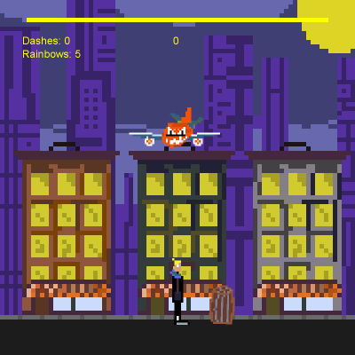
</p>

## Running it

You need JDK 17 or newer.

```sh
git clone https://github.com/madam6/Ollie-The-Game-Java-Edition.git
cd Ollie-The-Game-Java-Edition
./run.sh        # Windows: run.bat
```

The script compiles the sources into `build/` and starts `ollie.Game`. In IntelliJ IDEA you can open the folder and run `ollie.Game` directly, since the module and the library in `lib/` are already configured. Assets are read from `data/`, so the working directory has to be the project root.

## Controls

| Key | Action |
|---|---|
| A / D or ← / → | Walk |
| Space, W or ↑ | Jump |
| Q or Shift | Dash for as long as the key is held (uses one dash) |
| E | Rainbow attack (uses one rainbow) |

## Screenshots

| | |
|---|---|
| 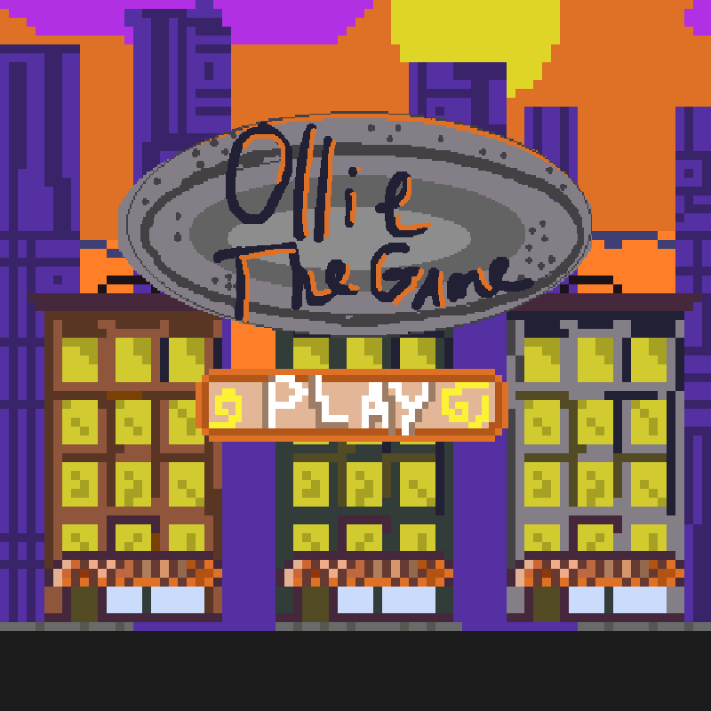 | 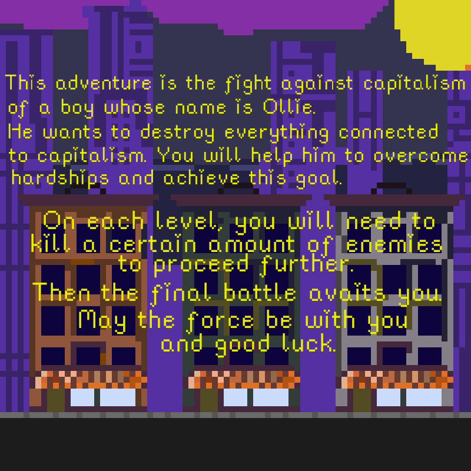 |
| Main menu | Story mode intro |
| 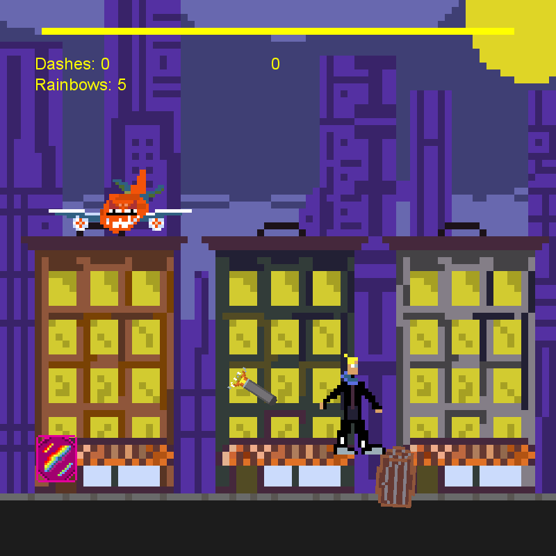 | 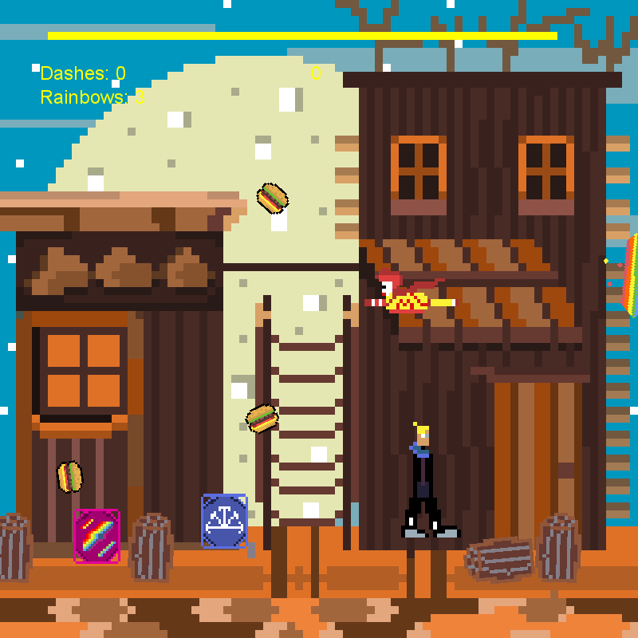 |
| Level 1: planes | Level 2: clowns throwing burgers |
| 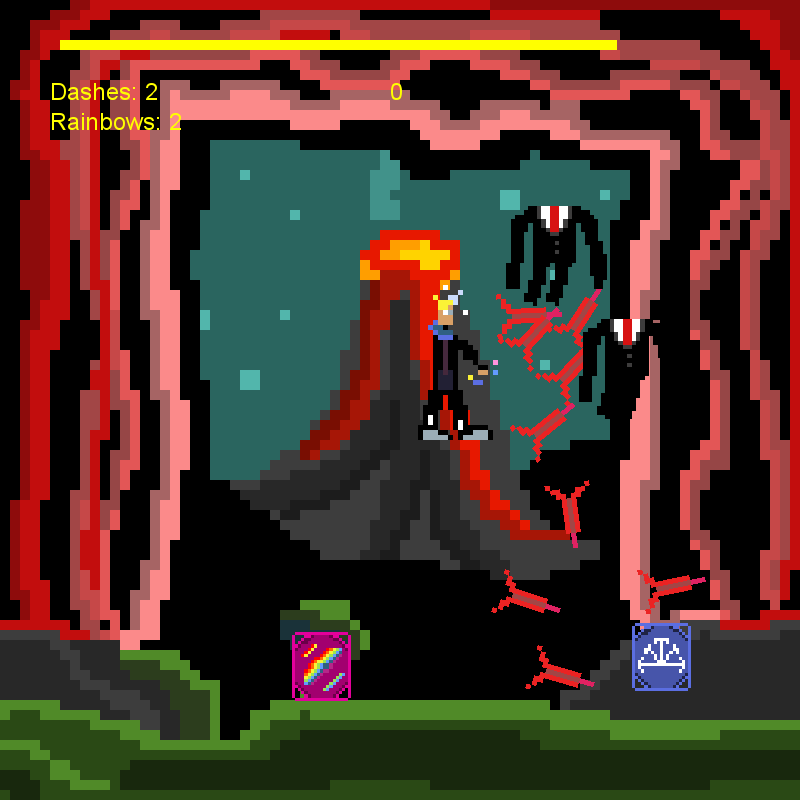 | 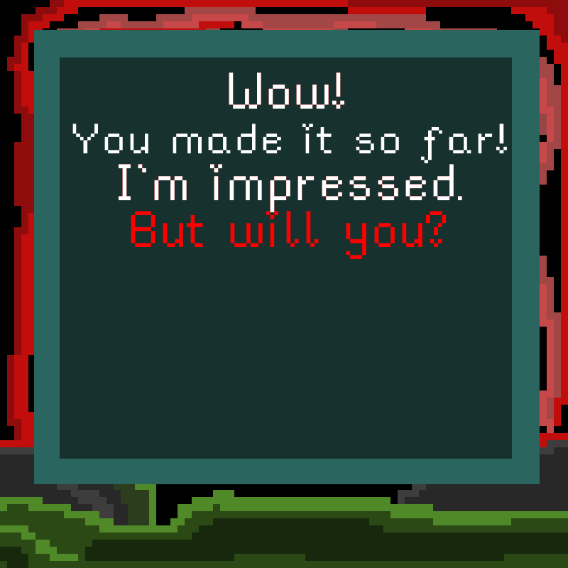 |
| Level 3: suits firing spreads in a cave lit by the volcano | One of the animated transitions between levels |
| 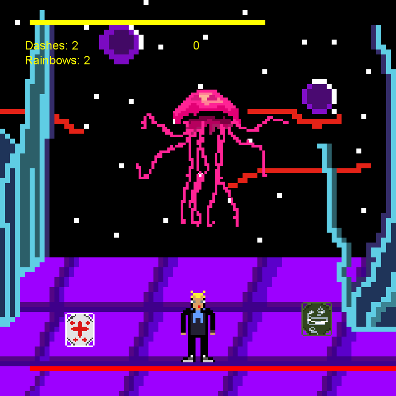 | 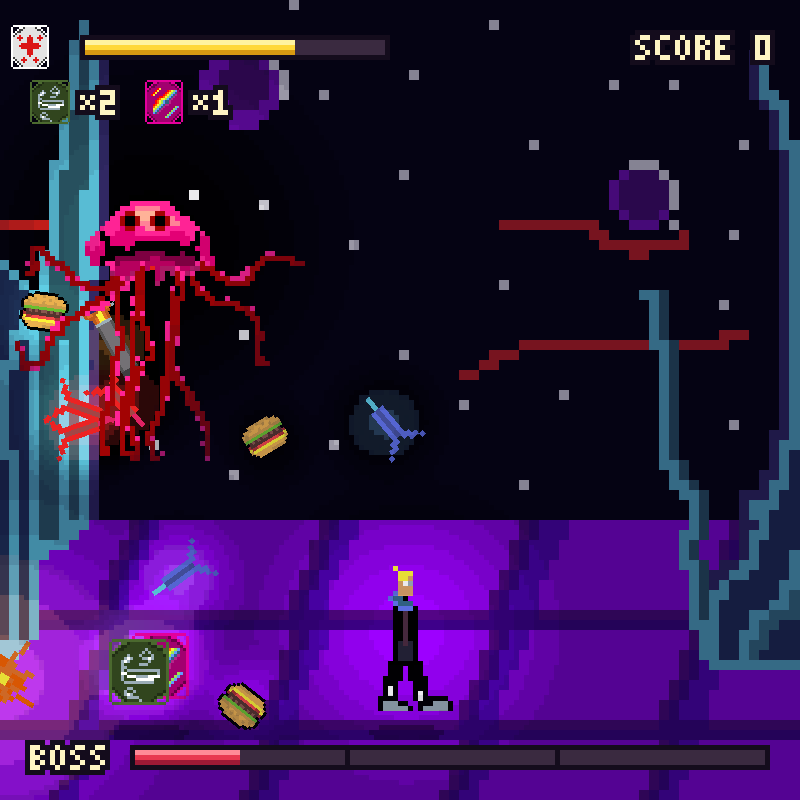 |
| Boss, first phase | Boss, third phase |
| 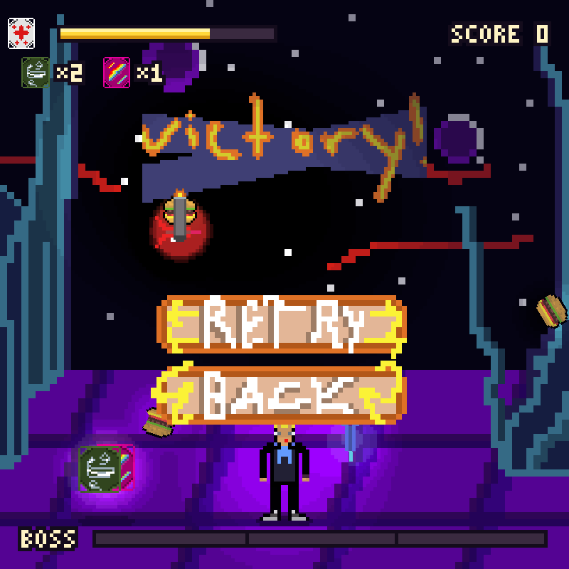 | 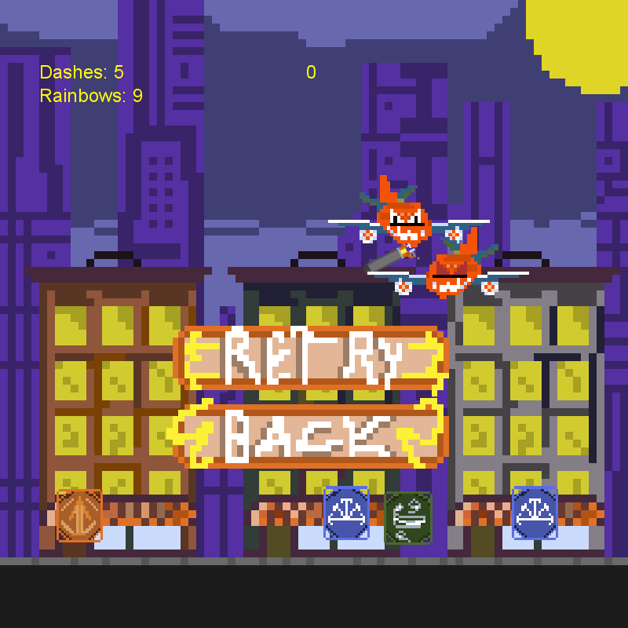 |
| Victory | Game over in endless mode |

## Enemies

| | Enemy | Attack | Points |
|---|---|---|---|
| 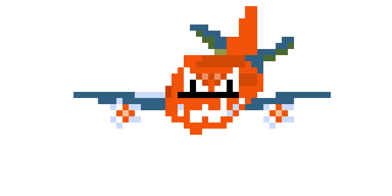 | Plane | A missile aimed at Ollie every 3 seconds. A direct hit is fatal, so dodge it or hide behind a barrel. | 10 |
| 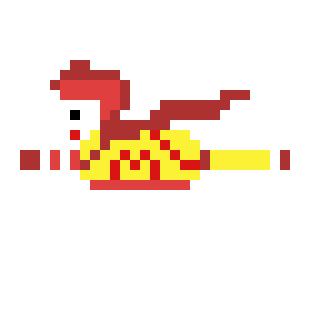 | Clown | Throws a burger every second. Burgers bounce between the walls for a few seconds and do 10 damage. | 5 |
| 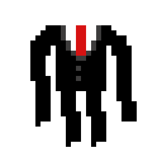 | Suit | Every 4 seconds, a fan of eight shots aimed downwards, 10 damage each. | 8 |
| 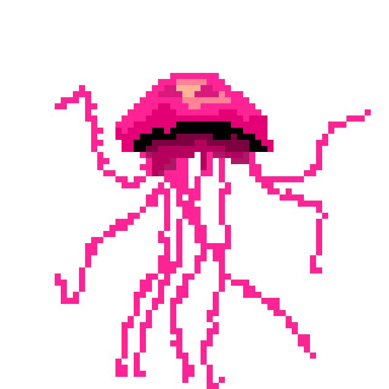 | Boss | 600 health over three phases. Fires missiles throughout, adds burgers below 400 health and the suit's spread below 200. | |

Rainbows kill a regular enemy in one hit and take 100 off the boss.

## Pickups

Pickups drop at random spots on the ground and disappear after 10 seconds.

| | Pickup | Effect |
|---|---|---|
| 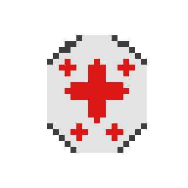 | Health | +150 health |
| 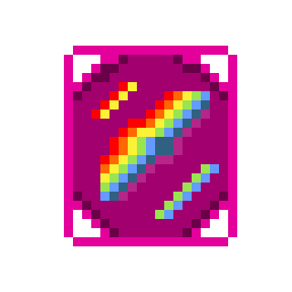 | Rainbow | +2 rainbows |
| 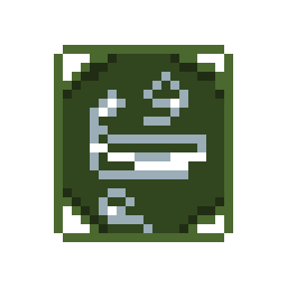 | Dash | +5 dashes |
| 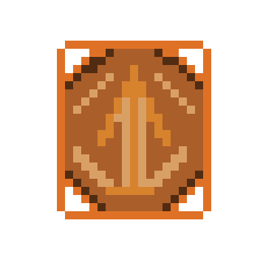 | Super jump | Launches Ollie into the air |
| 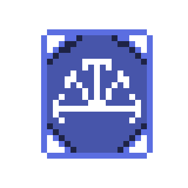 | Mass attack | Fires six shots upwards from where it was picked up |

In story mode each level ends after one kill: a plane, then a clown, then a suit. Health, dashes and rainbows carry over to the next level; the score doesn't. Endless mode sends planes, clowns and suits until Ollie dies.

## Code

```
src/ollie/
├── Game.java     window, menu and level flow
├── audio/        Sound: every clip in the game, decoded once and reused
├── levels/       GameLevel plus Level1-3, FinalLevel and EndlessLevel
├── characters/   Player, the Enemy base class, three enemy types and the Boss
├── bullets/      projectiles; each one handles its own collisions
├── items/        pickups and barrels
├── ui/           menu, in-game view, HUD, lighting, sprite sizing
└── input/        keyboard controls
```

Physics and drawing come from `lib/jbox2d-cityengine.jar`, which bundles JBox2D 2.2.1 with CityEngine, a thin Swing wrapper that City, University of London uses for teaching. The game uses its `World`, `Body` and `Walker` classes for the simulation and `UserView` for rendering. Collision rules, spawning, audio, menus and the HUD are in `src/`.

Each level is its own physics world. `GameLevel` owns the player, the spawn timers and the win and lose checks, and each subclass only describes its scenery and what spawns when. For example, level 1:

```java
@Override
public void begin() {
    playMusic(Sound.LEVEL1_MUSIC);
    addFlatGround();
    addSideWalls();
    new Barrel(this, 5, -12);

    spawnEvery(randomBetween(8_000, 10_000), 1_000, 4, () -> new PlaneEnemy(this, 40));
    spawnEvery(randomBetween(5_000, 10_000), Pickup.Kind.DASH);
    spawnEvery(randomBetween(3_000, 5_000), Pickup.Kind.RAINBOW);
}
```

The physics step, the spawn timers and input all run on the Swing event thread, so game state is never touched from two threads at once. The one exception is a background thread that decodes the sounds while the menu is showing.

## Rendering

The art is drawn on 32-pixel canvases and exported at 10 times that size. CityEngine sizes an image by its height in world units, and the original heights didn't divide evenly: enemies came out at 4.38 screen pixels per art pixel, pickups at 3.13 and bullets at 2.5. Some art pixels ended up a screen pixel wider than their neighbours, and sprites shimmered as they moved. `Sprite` picks heights that land on whole numbers instead. Characters, barrels and explosions use 5 screen pixels per art pixel, half the backgrounds' 10, and pickups and bullets use 3. Hitboxes were scaled to match.

`Lighting` adds glows, ground shadows and darkness on a grid of 5×5-pixel cells, one art pixel each, and scales the grid up without smoothing. Light falls off in flat bands, like hand-shaded pixel art. A glow adds light to the background colour under each cell, so a rainbow shot lights up the wall behind it. Level 3 and the boss fight are dark apart from the light around Ollie, shots, pickups, enemies and the volcano. Characters flash white when hit, and explosions and kills shake the screen. The HUD sits on the same 5-pixel grid and uses a small built-in font.

On the dark levels a full repaint, lighting included, takes about 1 ms.

## Performance

The first version loaded sound files from disk whenever something spawned. Every bullet, pickup and enemy decoded its own copies of its WAV files on the Swing thread, so each spawn froze the game for a moment. Now `Sound` decodes every file once, on a background thread while the menu is showing (about 430 ms and 92 MB of heap), and the clips are shared.

Measured on the same machine with the files already in the OS disk cache. "Before" is only the time spent loading sounds; "after" is the whole spawn, averaged over 50 runs.

| Event | Before | After |
|---|---|---|
| Plane spawns | 42.6 ms | < 0.1 ms |
| Suit spawns | 58.8 ms | < 0.1 ms |
| Suit fires its eight-shot spread | 136.8 ms | < 0.1 ms |
| Missile fired | 15.5 ms | < 0.1 ms |
| Burger thrown | 15.4 ms | < 0.1 ms |
| Pickup spawns | 7.4 ms | < 0.1 ms |

A frame at 60 FPS is 16.7 ms, so the old spread attack cost about eight frames on its own.

Other fixes from the same pass:

- The view now redraws at 60 FPS. CityEngine's default is 24, even though its physics already stepped at 60 Hz.
- Bullet timers kept repeating after the bullet was gone, and the spread-attack shots had no lifetime, so any that missed kept falling and being simulated until the game closed.
- Pickups were destroyed twice: once when collected and again when their 10-second timer fired. JBox2D doesn't check for this, so the second call decremented its body count again and relinked the body list through stale pointers.
- Level 1's pickup timers kept spawning into the old world after the level ended, and endless mode never stopped its spawn timers after a death, so they piled up with every retry.
- Every level also built a second `GameView` that was never shown, with its own button images and two extra bodies in the world.
- The player's sprite was removed and re-added every frame, even when it hadn't changed.

Bugs fixed along the way: retrying story mode could leave level 1 with no planes to spawn (the counter was static), the boss's health bar and its actual health were tracked separately and drifted apart, releasing any key while walking left stopped Ollie, holding the dash key spent every dash through key repeat, and pressing fire during the cooldown used up a rainbow without shooting.

## Known limitations

- The backgrounds are drawn at 10 screen pixels per art pixel and the characters at 5, so the scenery has half the detail of the characters in front of it. Matching them would mean redrawing the art.
- The game has to be started from the project root, because assets are loaded by relative path.
- The music is uncompressed WAV, which accounts for most of the repository's size (about 120 MB).
- Each sound has one clip, so triggering a sound that is already playing restarts it instead of layering a second copy.
- The window is a fixed 800×800.
- There are no automated tests. CI only checks that the project compiles.

## Credits and license

Made by Artem Korniienko, originally as coursework for a programming module at City, University of London.

`lib/jbox2d-cityengine.jar` contains [JBox2D](https://github.com/jbox2d/jbox2d) (BSD 2-Clause) and CityEngine (City, University of London). It isn't covered by this project's license. Everything else is under the [MIT License](LICENSE).
